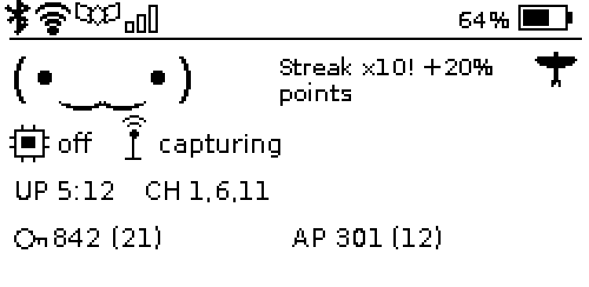

# Kestrel `age` plugin

A progression / gamification plugin for the [Kestrel](https://git.3ntropy.io/aluminum-ice/kestrel)
Wi-Fi capture device — ported from [AlienMajik's pwnagotchi `age` plugin](https://github.com/AlienMajik/pwnagotchi_plugins).

Your device "ages" with epochs and grows "stronger" over time, earns points for
handshakes, levels through named titles (with a little lore), develops a dominant
personality, and can **prestige** for a points multiplier. It adds a dashboard
readout, a web stats page, and — if you run the e-ink face — a rotating status
line on the panel itself.



## What it shows

- **Age** and **Strength** titles that unlock at thresholds, with lore on level-up
- **Network points** scored per handshake, with streak bonuses and optional
  repeat-AP diminishing returns
- **Personality** — aggro / stealth / scholar, with the dominant trait displayed
- A **progress bar** toward the next title, and **points decay** when idle
- **Prestige / rebirth** — reset for a higher points multiplier (auto or via the web page)
- **Handshake milestones** ("First Blood", "Legend", …)
- A **web stats page** at `/plugins/age/`
- A rotating **status line** on the e-ink panel (see [E-ink integration](#e-ink-integration))

## Requirements

- A device running **Kestrel** (e.g. a Raspberry Pi Zero 2 W, Pi 4/5)
- Python **3.11** (Kestrel's runtime)
- No extra packages — it's pure Python and local-only (nothing leaves the device,
  so no authorized-use acknowledgment is required)

## Install

Drop `age.py` into Kestrel's **operator plugin directory** and enable it:

```bash
# on the device
sudo mkdir -p /etc/kestrel/plugins          # create it if it doesn't exist
sudo install -m 0644 age.py /etc/kestrel/plugins/age.py
sudo kestrel plugins enable age
sudo kestrel plugins info age               # should read: loaded
```

> **Note on plugin directories.** Kestrel scans both `/usr/local/lib/kestrel/plugins/`
> (shipped) and `/etc/kestrel/plugins/` (operator). The operator dir is the right
> home — it survives updates and overrides a shipped plugin of the same name — but
> a **missing** directory is silently skipped, so create it first. The plugin's
> name is its filename (`age.py` → `age`), and a `.py` file with no `Plugin`
> subclass is ignored.

## Configuration

Set options at enable time (`--set key=value`) or on the dashboard Plugins page.

| Option | Default | Meaning |
| --- | --- | --- |
| `points_pmkid` | `5` | Points for a PMKID handshake |
| `points_eapol` | `5` | Points for an EAPOL handshake |
| `points_unknown` | `1` | Points for an unknown-type handshake |
| `passive_train_rate` | `0.1` | Strength gained per epoch |
| `decay_interval` | `50` | Idle epochs between decay ticks |
| `decay_amount` | `10` | Points lost per decay tick |
| `stealth_quiet_epochs` | `5` | Sustained quiet epochs per stealth point |
| `aggro_per_handshake` | `3` | Aggro gained per handshake |
| `repeat_ap_penalty` | `false` | Diminishing returns for re-capturing the same AP |
| `save_interval` | `60` | Min seconds between state saves (throttled, atomic) |
| `max_status_len` | `40` | Max characters on the status line |
| `prestige_bonus` | `0.1` | Multiplier added per prestige |
| `auto_rebirth` | `true` | Prestige automatically when the top titles are reached |
| `show_points` / `show_progress` / `show_personality` / `show_status` | — | Which readout elements to show |
| `data_path` | `""` | State file; blank → `<capture-store>/age/age_strength.json` |

## E-ink integration

When the Kestrel **e-ink face** plugin is running, `age` publishes its rotating
status line as an `age_status` service and the face shows it in the mascot's
voice band (level-ups, streaks, decay). It's an optional coupling — with no
e-ink plugin, `age` simply skips it; with no `age` plugin, the face is unchanged.

This needs a version of the `eink` plugin that consumes the `age_status` service.
Support for the **Waveshare 2.13" (250×122) panel**, a lower-flicker **partial
refresh** mode, and this `age_status` hook are in a patch against Kestrel —
see [Upstream](#upstream-the-kestrel-side).

## Differences from the pwnagotchi original

Three features couldn't carry over, because Kestrel's architecture doesn't expose
what they relied on. Each has a faithful substitute:

| Original | Why | Substitute |
| --- | --- | --- |
| Points by **encryption** (WPA3/WPA2/WEP/open) | Kestrel's `HandshakeEvent` exposes `type` (pmkid/eapol), not the encryption suite | Scored by handshake **type** |
| **Strength from AI training steps** | No `on_ai_training_step` hook (the board doesn't train on-device) | **Passive** per-epoch accrual |
| **Deauth / association** counters | Kestrel dispatches no such events | Dropped; aggro comes from handshakes |

Not yet ported (pure bookkeeping, PRs welcome): random events (time-warp /
windfall / personality-swap) and the time/encryption secret achievements.

## Testing

The tests run against the real Kestrel framework (loader, context, UI, handshake
events) with no hardware. Put the `kestrel_pi` package on your `PYTHONPATH`:

```bash
PYTHONPATH=/path/to/kestrel/builder/extra/files/kestrel_pi \
  python -m pytest tests/test_age.py -q
```

## Upstream (the Kestrel side)

The **e-ink display changes** — 2.13" panel support, partial-refresh flicker
control, and the `age_status` hook — modify Kestrel itself, which is
**GPL-3.0-or-later**. They belong upstream, not here: the proper home is a pull
request to [aluminum-ice/kestrel](https://git.3ntropy.io/aluminum-ice/kestrel).
This repository is just the `age` plugin (MIT), which is a standalone drop-in.

## Credits & licence

- Original `age` plugin © 2024 [AlienMajik](https://github.com/AlienMajik/pwnagotchi_plugins) (MIT)
- Kestrel port © 2026 Michael Charles (MIT)

Released under the MIT Licence — see [LICENSE](LICENSE).
